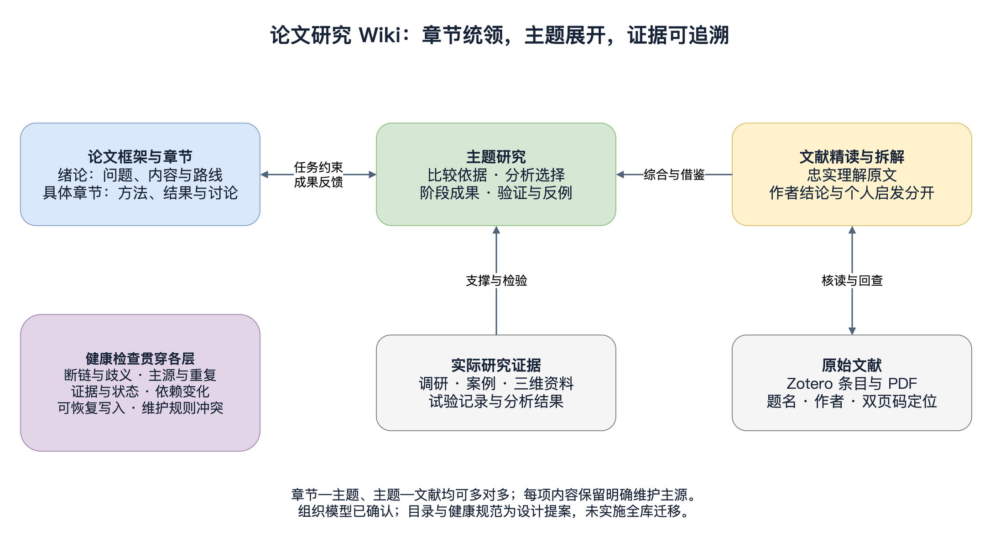

# 论文研究Wiki结构设计

> **接续说明：用户已授权全库改造。** 下文保留设计阶段措辞与原分期，实际实施和验收见[[项目管理/结构改造报告.md|改造报告]]；日常使用[[论文章节/README.md|研究工作台]]。本文不再作为“仅试点／未迁移”的当前状态依据。

> **组织模型已确认，具体结构为本轮设计提案，尚未实施全库迁移。** 用户于2026-10-28本次讨论确认四层组织模型，并要求设计Wiki结构和参考Wiki技能的健康性机制。本文件保存该确认及设计，不代表论文大纲已修订、研究主题已完成或全库已通过体检。

> **2026-11-04 子问题与论点规则更新：** 本文第3.3节“不必把每句话拆成独立原子卡片”及第八节“不强制增加原子卡片层”的取舍，已被[[项目管理/子问题与论点维护规则.md|子问题与论点维护规则]]取代：正式纳入研究的子问题和论点独立成页，但复用、迭代和合并仍按判断指引，不设数量阈值。本文保留为设计记录，不再作为当前卡片规则依据。

## 设计摘要

**以论文框架组织研究，以主题承载研究过程与成果，以精读和原始证据支撑判断。** 章节提出问题、调用主题；主题综合多篇文献与实际数据，形成阶段成果；成果化用为章节，并反哺绪论中的研究内容与路线。

- 一个Paper库，不另建独立Obsidian库，不复制Zotero原始PDF。
- 主导航按论文章节展开；共享主题保存在稳定位置，由多个章节链接。
- 主题是研究单元，不是关键词标签，也不等于一次任务或一份交付文件。
- 先加导航和关联，保留现有文献、图像、导图、基准、案例JSON及成果位置。
- 健康性分为结构、证据、研究覆盖、更新同步与恢复安全；不以文件数、链接密度或自动置信分数衡量研究成熟度。



[配套组织模型图](Wiki组织模型.png) · [可编辑图源](Wiki组织模型.drawio) · [技能核读与取舍](技能参考与取舍.md)

## 一、已确认模型与设计边界

### 1.1 四层及其反馈

| 层次 | 内容责任 | 不承担什么 |
| --- | --- | --- |
| 原始文献与研究证据 | Zotero条目与PDF；原始调研、图像、案例及试验记录 | 不因被收录就自动成为已核实事实 |
| 文献精读与拆解 | 文献身份、研究逻辑、方法、结论、原文定位；个人启发单列 | 不把作者结论直接写成本研究结论 |
| 主题研究 | 围绕本研究问题，比较依据、形成定义、开展试验、记录判断及成果 | 不是文献摘要拼接，也不是会话流水账 |
| 论文框架与章节 | 绪论统领问题和路线；后续章节展开方法、结果与讨论；正文组织完整论证 | 不复制所有研究过程，不预先承诺尚未成立的结论 |

自上而下：论文问题与框架提出主题任务，主题决定阅读、采集及验证需求。

自下而上：文献与实际工作形成主题成果，成果支撑或修正章节，再校正绪论。实际调研和实验材料可以直接进入主题研究，不必经过文献精读。

### 1.2 本轮不改变的研究主源

- 研究对象与方法目标仍以[项目context](../../context/PROJECT_CONTEXT.md)中的已确认决定为准。
- [现有v0.6工作稿](../../论文章节/全文工作稿/景宁畲族传统民居风貌特征提取与知识图谱构建研究v0.6.md)仅作为章节接续来源；其旧定位尚未整体对齐当前目标。
- 本设计不修改BOT定义、研究扩展、案例数据或Neo4j。基准与案例仍在其对应主源维护。
- 文献原文继续由Zotero管理；这里不对Zotero全库数量、附件可用性或阅读完成度作新结论。
- 不运行外部技能的自动迁移、历史聊天导入、自动提交、自动合并或重建程序。

## 二、目录结构：按论文章节浏览，按研究对象稳定维护

以下为**拟建目标结构**，不是现有目录清单。仅在有实际内容时创建页面；不预建全部小节、主题和管理文件。

```text
Paper/
├─ README.md                         项目总入口，链接论文研究入口
├─ 论文章节/                         拟新增：日常研究主导航
│  ├─ README.md                      论文框架、当前重点、待解决问题
│  ├─ 01-绪论/
│  │  └─ 章节导航.md                  研究问题、目标、内容与路线；关联后续章节
│  ├─ 02-研究对象与资料基础/
│  │  └─ 章节导航.md
│  ├─ 03-体系与方法设计/
│  │  └─ 章节导航.md
│  ├─ 04-案例实施与检验/
│  │  └─ 章节导航.md
│  ├─ 05-分析比较与讨论/
│  │  └─ 章节导航.md
│  ├─ 06-结论与展望/
│  │  └─ 章节导航.md
│  ├─ 主题研究/                      共享研究单元，不绑定章节号
│  │  └─ <明确的研究问题>/
│  │     ├─ 主题研究.md               当前认识、依据、选择、成果与缺口
│  │     ├─ <独立专题>.md             仅在内容需要独立维护时拆出
│  │     └─ <必要的原生导图>.smm.md   有阅读需要时建立，保持可编辑
│  └─ _管理/
│     ├─ 维护规则.md                 类型、命名、字段、权限和检查规则
│     ├─ 术语与标签.md               规范名、别名及不可合并项
│     ├─ 模板/                       章节导航、主题研究模板
│     └─ 健康检查/                   报告、范围清单和依赖核查基线
├─ 文献库/                           保留：精读主笔记与文献索引
├─ 研究资料/来源证据/                       保留：来源、证据记录、图像工作副本
├─ 研究成果/                          保留：既有正式成果包、基准、案例和展示
├─ context/                          保留：已确认决定与当前工作路由
├─ archive/                          保留：已被替代内容及其恢复索引
└─ 现有论文正文与其他有效文件          原位保留，先建立入口再评估整理
```

**文件夹名称是短导航名，不是擅自改定论文正式章名。** 第一轮章节标题及编号从v0.6读取；不适配当前目标的部分标为“待对齐”。章节目录经用户确认修订后再同步导航，不以本设计替换正文目录。

### 2.1 为什么共享主题不直接埋在一个章节文件夹里

用户从章节进入时，看到的仍然是“章—节—对应主题—成果—证据”。只是主题实体放在共享位置：一个主题可以服务第三章的方法、第四章的实施和第五章的讨论，不能复制三份维护。

这是一套章节导向的导航加一套共享内容，不是两个互相竞争的分类目录。初期每章一页，在页内按小节组织；只有某节已经积累独立的材料组织任务时才拆成文件。

### 2.2 首页只保留高价值入口

论文研究首页显示：当前研究问题与框架来源、章节列表、正在推进的主题、待决问题、最近一次健康检查的范围与结果。研究目标只作短摘要并链接context，不另维护一套决定。详细工作过程留在主题中，历史细节不堆在首页。

## 三、章节页与主题页：各管一件事

### 3.1 章节导航模板

每章用同一轻量结构，章节小节名称沿用当轮明确的大纲，不从主题列表倒推论文目录。

1. **本章任务与边界**：回答什么，承接前章什么，给后章什么。
2. **小节与论证准备**：每节准备建立的论点、所需证据、相关主题、材料缺口。
3. **主题成果采用表**：这是章节—主题采用关系的唯一人工维护位置。
4. **正文入口**：链接当前正文对应标题；准备页不维护另一套正式正文。
5. **对绪论的反馈**：哪些变化需要核对研究内容、方法、路线；未处理的反馈留在此处。

采用表字段：

| 小节定位 | 主题及具体成果 | 本节用途 | 采用状态 | 使用范围与限制 | 最后核对 |
| --- | --- | --- | --- | --- | --- |
| 大纲版本＋小节号或标题锚点 | 精确到主题段落／成果文件 | 总述／依据／方法／实施／结果／讨论 | 待映射／计划采用／已引用／需复核 | 不能从链接推断已经成立的内容 | 日期及必要的成果版本定位 |

“已引用”只表示正文已使用，不表示方法已验证。跨章多次使用同一成果时，每行写清不同用途。

### 3.2 绪论的特殊作用

绪论的研究内容与技术路线，连接后续章节的研究任务；后续章节反馈方法选择、实施范围和结果边界。绪论中的背景与相关研究仍需自己的证据，不只是目录缩写。

例如，“建立语义对象与三维区域关联”的总述，应能定位到方法展开、案例实施与验证讨论；如果尚未验证，绪论和正文均保留相应时态，不由主题文件存在推断任务完成。

### 3.3 主题研究模板

主题名称以要解决的问题或明确成果对象命名，而不是“第二阶段工作”“昨天讨论整理”。

1. **问题与范围**：研究什么、不研究什么、与其他主题如何分工。
2. **当前认识**：简短结论／方案，并逐项注明状态。
3. **依据与比较**：相关文献、实际数据、不同观点及冲突。
4. **我们的分析与选择**：采用理由、候选方案、被否定路径及其条件。
5. **阶段成果**：成果文件、主源、版本或核对定位、适用范围。
6. **验证与反例**：已做什么、未做什么、什么结果会推翻当前判断。
7. **待解决问题**：下一步需要的具体证据或试验；已解决项更新原处。
8. **论文贡献入口**：反向导航到采用它的章节；由章节采用表派生，不另手写一份采用状态表。

主题中关键判断采用轻量证据表，不必把每句话拆成独立“原子卡片”：

| 判断或成果 | 性质与状态 | 直接依据及定位 | 使用边界／反例 | 需要复核的条件 |
| --- | --- | --- | --- | --- |
| 一项明确判断 | 原文结论／综合推断／候选规则／工作规则／合成验证／实证结果 | 作者、完整题名入口、Zotero条目、印刷页与PDF页序；或数据与试验记录 | 地域、样本、时点、条件 | 来源修订、样本变化、反例出现等 |

“合成验证”必须说明验证了哪项表达／查询，不能等同于真实民居有效性。不同判断可以有不同状态，不用全页一个“已验证”覆盖。

### 3.4 独立主题的建立门槛

满足以下条件才建主题页：有明确问题；已有材料或具体研究任务；能说明它对论文的贡献；不被已有主题完整覆盖。单纯关键词用标签，单次步骤留在主题中，局部概念先写在相关主题内。主题拆分的理由是边界和维护需求，不是字数或文件数量指标。

## 四、现有材料如何接入：先链接，不复制

下表为第一批候选挂接方案，**不是已形成的主题成果或已确认的新章目**。章号以v0.6为定位参考，后续需对齐当前研究目标。

| 候选主题 | 可接入的既有材料 | 主要展开位置 | 其他贡献位置与边界 |
| --- | --- | --- | --- |
| 研究对象、尺度与样本边界 | context中的对象决定；候选对象底稿与村落资料入口 | 第二章 | 绪论简述边界；第四章说明实际样本。正式纳入标准仍待落实 |
| 风貌特征筛选与数据记录 | 夏雷专题拆解、畲族文献、现有资料收集口径 | 第三章3.2 | 第二章采集要求，第四章实施修订；现有候选不升格为正式字段 |
| 类型识别与语义关系表达 | 吴莹精读与导图、现有类型表达相关成果 | 第三章3.3 | 第五章类型比较和方法讨论；启发不等于已采用规则 |
| 多尺度语义模型与建模依据 | BOT基准、本研究优化基准 | 第三章 | 第四章实现对应；主题只综合采用理由，不重写现行定义 |
| 三维资料质量与空间区域关联 | 三维方法调研、模型资料缺口与关联目标 | 第二章2.4—2.5及第三章 | 第四章需要真实资料与关联检验；现有章目对空间关联的容纳方式待明确 |
| 合成试建与规则检验 | V01案例与其Neo4j入口 | 第三章试建／第四章方法检验定位待定 | 只作为合成语义表达与查询试验，不能充作实证样本 |
| 案例查询、风貌比较与有效性 | context中的验证目标及后续实际分析材料 | 第四、五章 | 目前主要是任务与证据需求，不能预写结果 |

现有入口：[文献库](../../文献库/README.md)、[夏雷专题](../../文献库/专题精读/夏雷数据与理论追溯/README.md)、[村落资料](../../研究资料/村落资料/README.md)、[建模原始基准](../../研究成果/〔建模依据〕知识图谱建模基准/BOT基准.md)、[研究优化基准](../../研究成果/〔建模依据〕知识图谱建模基准/本研究优化基准.md)、[V01案例入口](../../研究成果/〔合成试例〕虚拟民居单体试验V01/Neo4j/README.md)。

### 4.1 已有主源优先

- 基准、数据字典、案例JSON等已有明确维护主源时，主题页只概述采用理由、争议和验证任务，并链接主源。
- 导图保留原生可编辑文件；大量原文图像和逐项索引保留现有位置，不重复嵌入每个章节。
- 旧成果继续原位维护，只有角色不清或确已替代时才提出迁移／归档方案。
- 文献即便暂时没有进入某个章节，也可保留为储备或反证；不能为了“无孤立页面”强行建立关系。

## 五、关系与维护主源：避免新的重复

| 关系或信息 | 人工维护位置 | 其他页面如何使用 |
| --- | --- | --- |
| 文献身份及实际阅读范围 | 文献主笔记；身份回查Zotero | 链接，不复制阅读进度 |
| 主题依赖哪些文献、数据和基准 | 主题“依据与比较”及成果表 | 章节按主题回查，需要精确引用时下钻原文 |
| 主题支持哪些章节及如何采用 | 各章“主题成果采用表” | 主题反向入口与全局映射可生成，不另维护关系总表 |
| 现行规则、数据或实现细节 | 对应基准／案例／数据主源 | 主题、章节只概括并链接 |
| HTML／PNG等由哪份内容生成 | 派生文件的生成记录／相邻成果入口 | 主源变化时提示重新导出，不覆盖用户独立改动 |
| 研究定位与重大已确认决定 | context中的相应决定 | 章节与主题按其约束展开；不复制全文 |
| 待解决问题 | 问题所属主题或章节 | 首页汇总链接，不另建并行待办清单 |

一处事实可以有不同粒度的摘要，但只能有一处负责详细维护。相同来源的PDF、精读和摘要不能算作三个独立证据。

## 六、命名与最低字段

### 6.1 命名规则

| 对象 | 规则 | 示例（仅示意） |
| --- | --- | --- |
| 文献主笔记 | 作者-年份-短题 | 吴莹-2018-江南古镇语义网络量化.md |
| 文献专题 | 作者-年份-短题-专题 | 夏雷-2020-东北严寒地区村落风貌数据库-数据收集明细.md |
| 共享主题文件夹 | 问题或成果对象，不带章号与日期 | 风貌特征筛选与数据记录/ |
| 主题主页面 | 文件夹内固定入口 | 主题研究.md |
| 独立成果 | 对象或主题-内容或用途 | 风貌特征-候选筛选表.md |
| 一次性记录／固定交付 | 日期-主题-类型 | 2026-10-28-类型识别-核查记录.md |
| 成对图源与导出图 | 同名不同扩展名 | 关联模型.drawio、关联模型.png |

不使用“最终版”“最新版2”；持续维护文件不因每次补充改名。年份冲突先核查，不为整齐改造书目。L/E/D编号、案例V01、Zotero key等现有身份标识保留原值，不混同文件版本号。

旧文件命名不在本轮批量改变。确需改名时先做新旧路径表、入链检查与备份，并核对导图、HTML、图片、标题锚点和生成脚本。

### 6.2 最低字段与渐进接入

新Wiki页面建议必需字段：`wiki_id`（稳定且唯一）、`type`、`status`、`created`、`updated`、`summary`。标题以页面一级标题为准，不强制再维护重复的`title`。例如`wiki_id: topic-feature-selection`是拟用格式示意，不是已分配编号。

类型限定为章节导航、主题研究、管理说明、派生报告等明确角色；文献原有`literature-note`等有效类型保留。`status`描述文档维护状态，例如草稿、维护中、已替代、归档；研究判断的证据状态在主题证据表中逐项记录。

按实际需要增加：`aliases`、少量主题标签、`reviewed_at`及`review_scope`、派生文件的`canonical_source`、归档对象的`superseded_by`。没有实际审核不得填审核日期；没有接替文件不造替代关系。

旧文献不因缺少新字段就判为坏文件。第一阶段由现有入口接入，在实际修改时逐步补齐；健康报告区分新结构不合规与历史兼容项。共享目录中的多个“主题研究.md”和“章节导航.md”须使用完整库内路径或准确相对链接，不能只靠同名短链接解析。

## 七、健康性：检查研究链，而不只检查Markdown

### 7.1 检查范围分层

- **活动研究层**：拟新增论文研究目录，以及本轮明确纳入的文献和成果主源。检查结构、关系、状态和证据。
- **来源与派生资源**：检查被引用文件是否可达、来源定位和生成关系；不要求每张图片、每个JSON、HTML都像主题页一样有frontmatter。
- **历史与系统区**：归档不参与“当前成果成熟度”统计，但当前指向归档的引用仍检查可达性及角色；`.obsidian`、`.hermes-academic-backups`不作研究内容扫描。`.smm.md`按原生导图处理，不当普通笔记批量补字段。
- **外部服务**：Zotero或Linux服务不可用时，报告“未检查／不可用”，不判为资源已删除，也不把相关检查计为通过。

### 7.2 健康检查规则表

| 编号 | 检查对象 | 确定性检查／人工复核 | 处理原则 |
| --- | --- | --- | --- |
| H01 | 链接和附件 | 检查Markdown、Wiki链接、嵌入、相对路径、标题／块锚点；区分外链与Zotero链接 | 缺目标和多义同名链接报告为阻断；不按相似字自动替换 |
| H02 | 身份与主源 | 重复wiki_id、多个现行主源标记、相同Zotero条目候选重复 | 相似只是候选；区分同篇专题、不同版本和真正副本 |
| H03 | 章节覆盖 | 每个计划展开的小节是否有主题／证据入口或明确缺口说明 | 目录完整不等于成果完整；不生成空结论填洞 |
| H04 | 有效关联 | 从论文入口能否到达活跃主题、主要成果与依据 | 仅有“返回首页”不算研究关联；储备文献可明确保留 |
| H05 | 证据追溯 | 核心判断是否能回到来源及定位，是否区分直接阅读与二手引用 | 格式可自动检查，支持是否充分须人工核读 |
| H06 | 状态诚实 | 文献结论、个人推断、候选、工作规则、合成验证、实证结果是否混淆 | 不按页面年龄、链接数或来源数提升审核状态 |
| H07 | 依赖变化 | 对比来源内容指纹、已核对版本与派生记录 | 内容变化触发受影响判断“需复核”；仅mtime变动不是结论失效 |
| H08 | 冲突与反证 | 同一对象、时点、口径下是否存在不兼容判断 | 保留双方证据及适用边界，允许“已知且未解决” |
| H09 | 派生同步 | 主笔记／图源变化后HTML、PNG、导图相关内容是否需更新 | 源文件可读不等于展示已同步；独立编辑冲突先合并 |
| H10 | 命名与术语 | 规范名、别名冲突、旧路径残留、标签漂移 | 地名异写与同名建筑不自动合并；引用原文原貌保留 |
| H11 | 安全与可恢复 | 修改范围、最新SHA、备份、回读、未完成操作记录 | 有冲突或写入结果不明先读取；不得盲目重试或清库 |
| H12 | 维护稳定性 | 同样输入反复检查是否产生相同结果，规则是否互相改回 | 已否决建议保留理由，避免不同技能反复添加／删除同一关系 |

附件检查不能因外部技能默认跳过图片链接而省略。链接解析必须保留中文、大小写和原始标识，不能用统一转小写／空格转连字符“修复”路径。代码块、来源快照和历史路径对照中的示例不作为活动断链处理。

### 7.3 来源变化追踪

建议在健康检查区保存**机器生成的依赖核查基线**，记录依赖文件路径、内容SHA-256、核对时间／范围、受影响主题或派生文件。基线不是研究结论，不手工维护第二套内容。

没有旧基线时标记“尚未建立核对基线”，不能推断“没有变化”。源文件变化只触发复核提示，不自动重写研究判断。真正复核后才更新对应基线；不能只刷新日期消除告警。

### 7.4 报告不是一个“健康分数”

每次报告必须显示：范围与排除项、运行时间、检查规则版本、实查／未查项、定位、影响、建议、处理状态，以及未解决的证据问题。

建议按严重程度呈现：阻断使用的问题；需要复核的问题；可改善项。确定性错误数量与人工候选判断分开。没有证据条件完成的检查保留“未检查”，不计为零问题。

不把链接密度最大、所有主题互链或所有建议归零作为目标。合理的未决问题是健康研究的一部分；尚未完成的实验不是文件结构故障。

### 7.5 检查与修复分离

默认只读检查并生成报告。常规新建／更新任务可在已授权范围内同步相应入口；合并、迁移、删除、研究判断变更、范围扩展则先给出具体影响清单并取得对应授权。

经批准的机械修复流程：预览目标及差异 → 最新SHA读取 → 逐文件安全写入 → 回读 → 核对受影响引用和渲染。`mac-paper`提供逐文件保护，**不是跨文件原子事务**；批量动作需要操作清单与逐项完成记录，部分失败不得宣布整批成功。恢复也按当前文件重新核对，避免覆盖失败之后的用户编辑。

### 7.6 检查节奏与实现边界

- 每次成果更新：检查本次变化及直接依赖、入口和展示文件。
- 每次阶段性写作／汇报：检查所用章节、主题、证据及版本。
- 经用户安排的周期体检：检查活动研究范围，必要时比较前后报告；本轮不创建定时任务。

现有技能示例中的`04_meta/scripts/kcs_lint.py`在本次目标路径读取中不存在，不能声称已经运行。**本轮只完成规范设计及交付文件检查；面向全库的检查器、基线和首次健康报告均待后续实施。**

## 八、Wiki技能的采用与排除

详细核读定位及固定版本见[技能参考与取舍](技能参考与取舍.md)。以下是设计取舍，不是已安装或执行的能力列表。

| 参考技能 | 借鉴部分 | 为本研究作的限制 |
| --- | --- | --- |
| 本机obsidian-knowledge-manager | 主题综合、问题保留、成果回链、渐进维护 | 不强制增加原子卡片层，不搬入默认四目录 |
| Ar9av wiki-lint | 断链、来源变化、冲突、身份与索引检查；先报告 | 不采用年龄自动晋升、缺标记默认可靠、模糊替换和自动提交 |
| Ar9av wiki-dedup | 先候选检测，再全文比较；保留来源、别名与修复入链 | 不使用自动合并，不按链接数／篇幅选主源，不重算伪精确可信分数 |
| Ar9av wiki-status | 新增／变化／未变／暂不可用分类；维护相互冲突检查 | 未设manifest不等于空库；不扫描其他代理历史，不用图密度衡量学术质量 |
| Ar9av cross-linker | 识别未链接提及，给出关联理由 | 共词／同标签仅供候选；不自动升级为支持、矛盾、推导等证据关系 |
| Ar9av tag-taxonomy | 规范名与别名表、先查词表 | 保留专业区分和地名身份；不强制英文标签、不把上位词当同义词 |
| Ar9av wiki-synthesize | 跨文献综合、冲突、最强反对意见、可检验问题 | 主题由研究问题驱动，不按共现分数批量造页面或结论 |
| Ar9av wiki-context-pack | 按任务提取有限范围且可引用的材料；只读 | 写章前提取问题、主题、证据和缺口，不把整库或管理规则混成证据 |
| AgriciDaniel wiki | 接纳现有库、预览差异、明确范围、来源保真、恢复意识 | 不安装其写入核心接管Paper；采用现有mac-paper保护，并说明逐文件限制 |
| kepano obsidian-skills | Markdown、Bases和Canvas等表达能力的分工 | 第一阶段不依赖新插件；Bases仅作可再生视图，不新增事实主源 |

## 九、实施分期与验收

### 阶段A：建立导航，不搬家

从用户确认的大纲建立论文研究首页与章节页；若暂用v0.6，明确“待对齐当前目标”。链接既有文献与成果，不修改它们的研究结论。建立首批主题时选边界清楚、材料已有的实际问题，不一次铺满所有主题。

验收：从章节可到主题，从主题可到成果和依据；每条采用关系说明用途；现有文件和旧入口仍可用。

### 阶段B：试运行两条研究链

建议先以“风貌特征筛选与数据记录”和“类型识别与语义关系表达”作试点，分别接入夏雷和吴莹相关积累，并按需要关联其他来源。检验它们能否支撑不同章节，而不是把两篇文献直接改名为两个主题。

验收：主题确实包含我们的研究问题、综合判断和缺口；可以追到单篇精读与原文；候选借鉴与正式采用分开。未实际核读的原文保留未核读状态。

### 阶段C：建立健康基线，再做必要整理

实现并测试只读检查器，输出首轮范围明确的报告；针对已确认重复／旧路径再提出改名或归档清单。新字段渐进接入，不全库强制清洗。

检查器至少用以下测试夹具验证后才应用正式库：正常链接、中文及空格路径、同名文件歧义、Markdown与Wiki混合链接、缺失附件、标题／块锚点、代码示例、归档引用、导图文件、不可用Zotero入口、缺失基线、纯时间变动、真实内容变动、重复ID和替代关系循环。

验收：已知测试错误能检出；合法示例不误报；只读模式不改主源；同一内容重复运行结果稳定；报告展示未检查范围；修复后旧引用和新入口均核验。测试通过不等于论文证据已验证。

### 阶段D：写作与研究持续循环

写作前按章节提取材料包；正文采用后更新章节采用表。主题变化时，核对受影响章节与绪论；论文变化提出新问题时回到主题，不为顺从旧目录压掉反例。

## 十、本轮交付与未执行事项

本轮交付：结构设计、技能核读取舍、可编辑组织模型图及预览，外部技能固定版本参考快照；已确认组织模型的简短记录与入口链接。设计稿保存不等于细节已获用户批准。

未执行：全库搬迁、批量改名、主题内容重写、Zotero整理、数据库变更、第三方Wiki框架安装、全库健康检查或定时维护。没有把本文拟建目录实例化为一批空页面。

本设计的最终判断标准是：**我们能否从论文问题找到当前研究成果、从成果回到可靠依据，并明确知道哪里仍未解决。**
